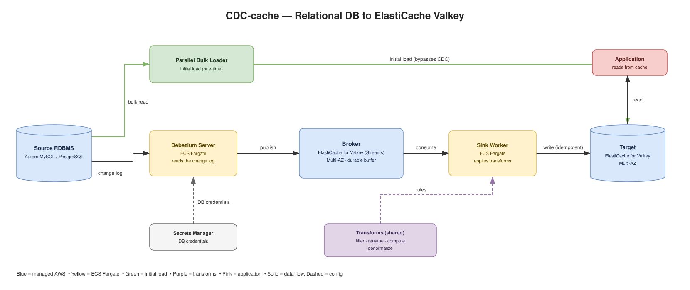

# CDC-to-ElastiCache prototype

CDC-cache streams changes from a relational database into Amazon ElastiCache for
Valkey in real time (Change Data Capture), so applications can read hot data
from the cache at sub-millisecond latency instead of hitting the database.

It also includes a parallel bulk loader for the one-time initial load, and
data transforms (row filters, column selection, computed fields, aggregations,
denormalization) applied on the way into the cache.

## For testers — start here

**Where to run:** ElastiCache is VPC-only (no public endpoint), so the test must
run **inside the VPC** — but you don't need a standing EC2. Easiest and free:
**AWS CloudShell attached to your VPC** (a private subnet) — browser-based, no EC2
to provision or pay for. Any in-VPC host (EC2/Cloud9) or an ephemeral Fargate/
CodeBuild task works too. A laptop can't reach the private DB/cache endpoints.

**Setup (one-time):**
```bash
# AWS creds working (aws sts get-caller-identity), then:
pip3 install pymysql valkey        # valkey-cli optional (nicer verify output)
cd contrib/cdc-elasticache-prototype
```

**Run it — one command:**
```bash
./quickstart.sh all
```
Runs, in order: preflight → deploy Aurora source + Valkey target (CloudFormation,
**~10–15 min**) → seed sample data → bulk-load into Valkey with transforms → verify.
No password to set — it's auto-fetched from the secret RDS creates for the
deployed Aurora.

**See your results:** the `verify` step prints sample cache objects, e.g.
`products:1` (only *active* products, with a computed `price_cents`), `merchants:1`
(with `tier` renamed from `risk_tier`, timestamps dropped), `users:1`,
`customer_kyc:1`. Inspect more anytime:
```bash
valkey-cli -h <target-endpoint> -p 6379 --tls -c DBSIZE
valkey-cli -h <target-endpoint> -p 6379 --tls -c HGETALL products:5
```

**Status / errors:**
```bash
./quickstart.sh status     # CloudFormation stack status
# deploy failures:
aws cloudformation describe-stack-events --stack-name cdc-cache-demo-source
```

**Run stages individually / clean up:**
```bash
./quickstart.sh deploy | seed | load | verify   # any single stage
./quickstart.sh teardown                          # delete both stacks (stop paying)
```

**Bring your own DB/cache instead of deploying:** export `SOURCE_DB_HOST`,
`SOURCE_DB_SECRET_ARN` (a Secrets Manager secret with `username` and `password`), and `VALKEY_HOST` first — the script uses those (BYO mode)
and skips the deploy.

## Architecture (current)



<sub>Editable source: `docs/architecture.drawio` (Draw.io Integration extension or [app.diagrams.net](https://app.diagrams.net)). Text version below.</sub>

```
Aurora / RDS (MySQL or PostgreSQL)
        │  binlog / WAL
        ▼
Debezium Server            ← reads the change log (runs on ECS Fargate)
        │  change events
        ▼
Broker  (ElastiCache for Valkey Streams)      ← durable buffer (cluster mode DISABLED)
        │
        ▼
Sink Worker (ECS Fargate)  ← consumes streams, applies transforms, idempotent HSETs
        │
        ▼
Target  (ElastiCache for Valkey)   ← the application reads here
```

- **No Kafka, no Zookeeper, no UI.** Earlier versions used Kafka/MSK and a web
  UI; those are retired. The pipeline is Debezium Server → Valkey Streams broker
  → Go sink → Valkey target. (The old React frontend and control plane are not part of
  this snapshot — run CDC-cache via `quickstart.sh`/CloudFormation.)
- **Initial load** (`data-plane/bulk-loader/`) does a fast parallel PK-range read
  straight into the target; Debezium then takes over for steady-state CDC.
- Both broker and target are **managed ElastiCache for Valkey**.

## Quickstart — one command to test it

From a host **inside your VPC** (EC2/Cloud9), with awscli configured and
`pip3 install pymysql valkey`:

```bash
./quickstart.sh all
```

That single command:
1. Deploys a small **Aurora MySQL** source and a small **Valkey** target
   (CloudFormation, auto-detects your default VPC/subnets).
2. Fetches the DB password from the RDS-managed Secrets Manager secret
   (nothing hardcoded).
3. Seeds a sample workload (`users`, `merchants`, `products`, `customer_kyc`,
   `customer_txn_aggregates`).
4. Bulk-loads each table into Valkey with **transforms applied**.
5. Verifies the keys landed (e.g. `products:*` only for active products, with a
   computed `price_cents`; `merchants:*` with `risk_tier` renamed to `tier`).

Run stages individually if you prefer:

```bash
./quickstart.sh deploy     # create the infra
./quickstart.sh seed       # schema + sample data
./quickstart.sh load       # load into Valkey with transforms
./quickstart.sh verify     # check the cached objects
./quickstart.sh status     # stack status
./quickstart.sh teardown   # delete both stacks
```

Common overrides (env vars): `AWS_PROFILE`, `AWS_REGION` (required),
`CDC_CACHE_PREFIX`, `CDC_CACHE_VPC_ID` + `CDC_CACHE_SUBNET_IDS`, `CDC_CACHE_USERS/MERCHANTS/PRODUCTS`.

## What's in the repo

| Path | What |
|---|---|
| `quickstart.sh` | One-command deploy → seed → load → verify (start here). |
| `infra/` | CloudFormation for the **managed** path: Aurora Serverless source (`aurora-serverless-{mysql,postgres}.yaml`), Valkey broker (`broker-single.yaml`, cluster-mode disabled — the CDC broker), Valkey target + monitoring (`valkey-cluster-with-monitoring.yaml`), Debezium+sink on ECS (`v3-debezium.yaml`, `cdc-ecs.yaml`). |
| `data-plane/` | The runtime: Debezium Server config, the Go/Python sink workers, and the parallel bulk loader. See `data-plane/README-v3.md`. |
| `examples/my-pipeline/setup/` | The runnable sample workload (schema, seeder, transform spec) that `quickstart.sh` uses. |
| `legacy-kafka-sink/` | The earlier Python Kafka sink workers (aggregations, write modes, last-writer-wins), kept for reference. |
| `tools/` | The Go sink, Go bulk loader, splitter and aggregator, benchmark harnesses and load generators, and the live observability panel (`observe.py`). |
| `docs/` | Architecture (`architecture.md`/`.drawio`), and the benchmark writeups (`docs/benchmarks/`). |

## Full CDC pipeline & transforms

`quickstart.sh` proves the tool end to end via the bulk-loader path. For **live
CDC** and **denormalization** (merging a child table into a parent cache object),
deploy the full pipeline with `./quickstart.sh cdc`.
Transforms are defined per table:
- Shared filter/computed/columns/rename spec: `examples/my-pipeline/setup/transforms.json`
  (used by the bulk loader and the Go sink).

## Checking status & errors

- **Infra:** `./quickstart.sh status`, or the CloudFormation console →
  `aws cloudformation describe-stack-events --stack-name cdc-cache-demo-source`.
- **CDC pipeline (ECS):** CloudWatch Logs `/ecs/{stack}/debezium` and
  `/ecs/{stack}/sink-worker`; sink health at `:8081/health`, metrics at `:8081/metrics`.
- **Cache:** `valkey-cli -h <target> -p 6379 --tls -c ping`, and the CloudWatch
  dashboard created by the target stack (see its `DashboardName` output).

## Benchmarks

Want to benchmark, not just functionally test?

```bash
./quickstart.sh benchmark        # initial-load throughput (needs only source + target)
./quickstart.sh benchmark-cdc    # end-to-end CDC throughput (needs the full pipeline deployed)
```
Raise the size with `CDC_CACHE_BENCH_SIZES=1000000,2000000,5000000` to reproduce the
published numbers. Full methodology, results, and step-by-step reproduction are in
[`docs/benchmarks/`](docs/benchmarks/) — initial load, CDC ceiling, sink drain vs
Kafka, denormalization, and PostgreSQL source.
