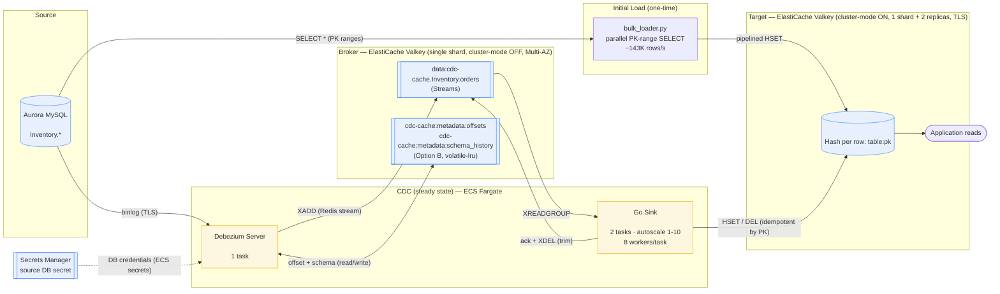

# CDC-cache Architecture (as deployed)

Account `<account-id>` · `<region>` · VPC `<vpc-id>`

> Rendered view above (`architecture.svg`). The editable source is
> `architecture.drawio` (open with the Draw.io Integration extension or
> [app.diagrams.net](https://app.diagrams.net)). A text-based version follows.

## Two data paths

1. **Initial load** — `bulk_loader.py` reads the source directly via parallel PK-range
   `SELECT`s and pipelines `HSET` straight into the target. Bypasses Debezium/broker.
   Volume tool (verified 1M/2M/5M @ ~127–147K rows/s).
2. **CDC (steady state)** — Aurora binlog → Debezium (ECS) → broker Streams → Go sink (ECS)
   → target. Offsets + schema history live in the broker (Option B, no SQLite/EFS).

## Key properties
- **Idempotent target writes** (`HSET`/`DEL` keyed by `table:pk`) → safe replays.
- **Bounded broker memory** — sink `XACK`s then `XDEL`s processed entries.
- **Offset safety** — `volatile-lru` never evicts the no-TTL offset key.
- **Scaling** — per-task `WORKERS` + ECS autoscaling; multiple sink tasks share one stream
  via the consumer group (unique `CONSUMER_PREFIX`).
- **Secrets** — DB user and password from the Secrets Manager secret, injected into the Debezium task by ECS (`secrets`, `valueFrom`).

## Current transformation behavior
- 1:1 mapping: each source row → one Valkey Hash (`table:pk`), all columns as string fields.
- Debezium applies routing (`RegexRouter` → `data:` prefix) + flat JSON only.
- Rich transforms (row filters, computed fields, denormalize, column selection) are **not**
  yet in the Go sink/bulk loader — gap to close if needed.

## Not yet deployed / known gaps
- Multi-shard partitioned throughput path (high-rate CDC).
- Multi-table (one sink service per stream today).
- DLQ, pipeline CloudWatch alarms + CDC-lag alarm, reconciliation job.
- Retire old Kafka/MSK stack (still live, untouched).

> The EC2 host (`<benchmark-host>`) is **not** in the architecture — it is only the
> container-image builder now; the pipeline it used during bring-up is stopped.
