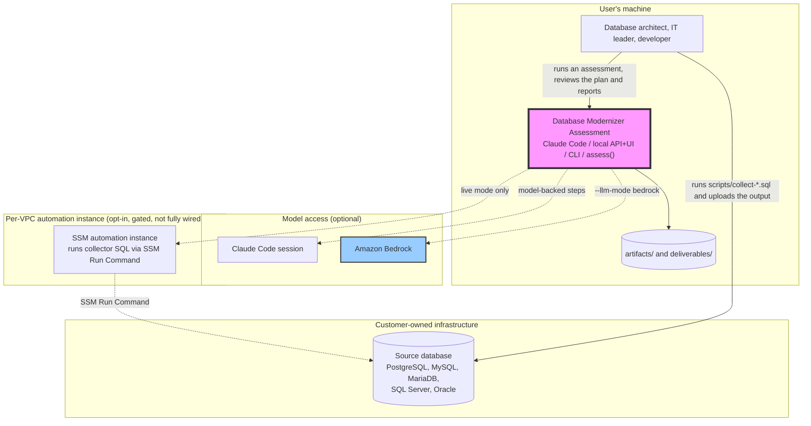

# System Context

External actors and systems for Database Modernizer Assessment. Runs
local-first — on the user's machine via Claude Code, the local API/UI, or
the deterministic CLI — not as a hosted service in a customer AWS account
(the prior hosted deployment was retired, [#175](https://github.com/aws-samples/sample-aws-genai-db-modernizer/issues/175)).

## Key points

- **The normal path needs no connection from the tool to the database.** The user runs one of the read-only scripts (`scripts/collect-postgresql.sql`, `collect-mysql.sql`, `collect-sqlserver.sql`, `collect-oracle.sql`) against their own database and gives the tool the JSON it writes. Redis is not a source database.
- **Live collection is opt-in.** It never connects directly from wherever the tool runs: it runs through SSM Run Command on a per-VPC automation instance (`infrastructure/cloudformation/automation.yaml`, `src/tools/aws/ssm_executor.py`), gated behind `MODERNIZER_ENABLE_AUTOMATION=1` and not fully wired end to end ([#342](https://github.com/aws-samples/sample-aws-genai-db-modernizer/issues/342)).
- **The model is Claude Code or Bedrock, and optional.** In a Claude Code session the model runs through the session (`--llm-mode external`); with `--llm-mode bedrock` Strands agents call Bedrock with the user's own credentials; `--llm-mode none` calls no model.
- **Nothing is hosted.** There is no hosted account, Cognito, or S3, DynamoDB, EventBridge or Step Functions in the default path; those existed only in the retired hosted deployment ([#175](https://github.com/aws-samples/sample-aws-genai-db-modernizer/issues/175)). The separate AWS Transform integration (`src/atx_orchestrator/`) uses S3 and is independent of this local path.
- The tool does not deploy its own database instances.

---

**Related:** [High-Level Design](../high-level-design.md)
