# Pipeline and Data Flow

The current pipeline, from a source database to the customer deliverables. `LocalOrchestrator` runs each phase as a direct function call over the artifact store; there is no workflow service or event bus. The phases are the `Phase` enum in `src/contracts/phase_models.py`.

There is **one** human approval gate, after the reality check (`assignment_review`, [ADR-028](https://github.com/aws-samples/sample-aws-genai-db-modernizer/blob/main/docs/architecture/decisions/ADR-028-customer-assignment-review-gate.md)). Nothing waits for approval after triage.

```mermaid
graph LR
    subgraph "Input"
        SCRIPTS["collect-*.sql output<br/>(raw collection JSON)"]
        SAMPLE["Bundled sample"]
    end

    subgraph "Pipeline (LocalOrchestrator)"
        COLLECT["Collect<br/>offline parser to CollectorOutputContract"]
        TRIAGE["Triage<br/>deterministic, honours the engine scope"]
        subgraph ANALYSIS_MAP["Analysis (one per selected engine, concurrent)"]
            ANALYSIS["Analysis<br/>patterns, anti-patterns, decision trace"]
        end
        ASSIGN["Assignment<br/>one per-query scorer, write groups,<br/>tie-break; every change is a Move"]
        RC["Reality check<br/>engine consolidation review"]
        GATE{"Assignment review<br/>the one human gate"}
        subgraph SCHEMA_MAP["Schema design (one per assigned engine, concurrent)"]
            SCHEMA["Designer and reviewer<br/>always uses a model"]
        end
        LOAD["Load test<br/>optional"]
        SYNTH["Synthesis<br/>facts computed once into report.json"]
    end

    subgraph "Output"
        DELIV["deliverables/<br/>executive report PDF, engineering reports,<br/>assessment-data.json, index.md"]
    end

    SCRIPTS --> COLLECT
    SAMPLE --> COLLECT
    COLLECT --> TRIAGE --> ANALYSIS_MAP --> ASSIGN --> RC --> GATE
    GATE -->|approved or edited| SCHEMA_MAP --> LOAD --> SYNTH
    GATE -.->|a customer edit writes a new assignment version| ASSIGN
    SYNTH --> DELIV

    style GATE fill:#fd7,stroke:#333,stroke-width:2px
    style ASSIGN fill:#fc9,stroke:#333,stroke-width:2px
    style RC fill:#fc9,stroke:#333,stroke-width:2px
    style SYNTH fill:#fc9,stroke:#333,stroke-width:2px
```



## Where each choice is made

- **Routing is deterministic.** Each query is scored against each engine by `query_scoring.score_query_for_engine`, from the rule catalog in `src/catalog/` ([ADR-031](https://github.com/aws-samples/sample-aws-genai-db-modernizer/blob/main/docs/architecture/decisions/ADR-031-query-first-routing-and-engine-rule-catalog.md)). A table has one writer (its writes form a write group); reads are placed per query. Only `move_ledger.apply` writes an engine, so each query carries its history of Moves.
- **A model explains, never decides.** The model-backed steps are the reality-check review, schema design and its reviewer, and the executive summary. `--llm-mode none` skips them (schema design is skipped with a stated reason).
- **Engine scope.** `--target-databases` limits the engines a plan may use; the scope is recorded under `decisions/engine_scope.json`, and triage skips engines outside it.
- **Versions.** Reality check and customer edits write a new `assignment/v<N>/`; schema design and synthesis are keyed on that version.
- **Library.** `assess()` (`src/assessment/`) runs the same phases in process up to a chosen `run_through` and returns a typed result ([contracts/assess.md](../../contracts/assess.md)).

## Artifacts

`job_id` is a UUID; the local scripts truncate it to 8 hex characters. `{database-name}` must match the real database name (the collection records it); a mismatch breaks table ids across phases. The default store is the local filesystem (`./artifacts/`); the AWS Transform integration uses the same layout in S3.

```text
{artifact-root}/{database-name}/{job-id}/
├── uploads/                                  the raw collection (raw input only)
├── collector/output.json
├── referee-triage/triage.json
├── analysis-{engine}/analysis.json           (one per selected engine, with decision-trace.json)
├── assignment/v{N}/assignment.json           (+ access_patterns.json; a new version per revision)
├── reality-check/output.json
├── decisions/                                (approvals and the engine scope)
├── schema-{engine}/v{N}/schema_output.json   (one per assigned engine)
├── load-test-{engine}/v{N}/                  (optional)
├── synthesis/v{N}/report.json
└── deliverables/                             (the latest version's customer folder)
```

Phase progression (`collect_triage`, `analysis`, `assignment`, `reality_check`, `assignment_review`, `schema_design`, `load_test`, `synthesis`) is kept in a progression file, `.meta/<job_id>.json`, at the store root. The full list of files, by kind, is [contracts/artifacts.md](../../contracts/artifacts.md); the storage layer is the [storage guide](../../guides/storage-architecture-guide.md).

---

**Related:** [System Context](01-system-context.md) | [High-Level Design](../high-level-design.md) | [ADR index](../decisions/README.md)
