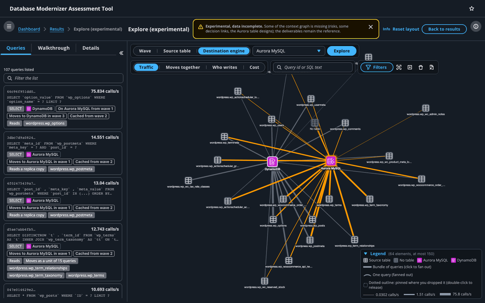
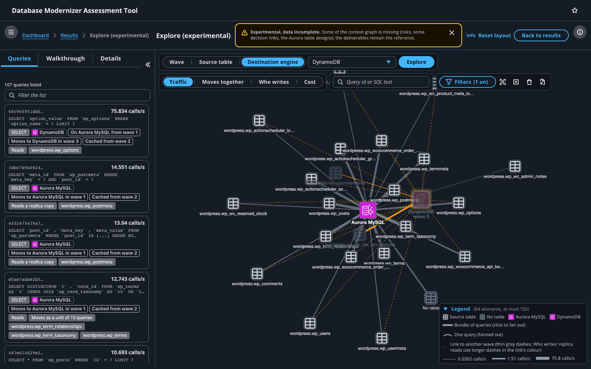
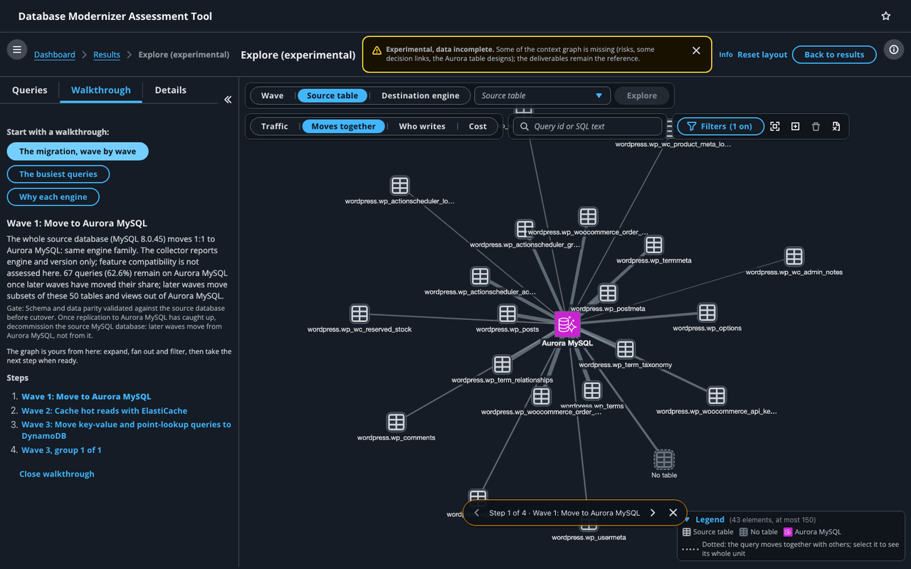

# Explore the graph (experimental)

The graph explorer is an experimental page of the local UI. It draws one assessment's context graph: the source tables and the destination engines, linked by the queries that move between them. You can start from a wave, a table, an engine or a single query, expand from there, and follow the assessment's own reasoning in guided walkthroughs.

!!! warning "Experimental, data incomplete"
    The explorer is a first pass. It is off by default, it may change or go away, and the context graph does not hold everything yet. Risks and every engine's design, Aurora included, are in it; still missing are the design targets per assignment version, the scores on every engine, the version history and the read/write split, and the explorer reads waves, move units, writers and costs from the job's files instead of the graph (completing the graph data is tracked in [#306](https://github.com/aws-samples/sample-aws-genai-db-modernizer/issues/306)). The explorer does not show risks yet. An empty result does not mean there is nothing there. The deliverables and the results page remain the reference.



## Turn it on

Start the local API and UI with the explorer on, and print a job's explorer URL, in one command:

```bash
uv run python scripts/start_local_ui.py --experimental-graph-explorer --page explore --job-id <job_id>
```

`make explore JOB=<job_id>` runs the same command (`make explore` alone only starts the servers). The JSON line it prints carries `"experimental_graph_explorer": true` and the page's `ui_url`, for example `http://localhost:3000/analysis/explore/<job_id>`. Servers already running without the explorer are restarted with it, and the next start without the option restarts them without it. Stop them with `uv run python scripts/start_local_ui.py --stop`.

The option sets one environment variable on the API, `MODERNIZER_EXPERIMENTAL_GRAPH_UI=1`. To run the API on its own (for example with `make local-api` or your own `uvicorn` command), set that variable yourself; `start_local_ui.py` without the option starts the API with it unset, even when your shell exports it. Nothing else turns it on: without it (or with any value but `1`) the results page asks the API and is told the explorer is off, so it shows no entry, and the explorer's data routes answer 404 to every request, like a path that does not exist. `/modernize`, the headless runs and everything else are unchanged.

With the explorer on, a job's results page carries an **Explore (experimental)** button that opens it.

## The workspace

- **The panel** on the left has three tabs: **Queries** (the queries drawn in the graph, busiest first, with a filter box), **Walkthrough** and **Details** (whatever you select). Drag its edge to resize it, or press `[` to collapse it and give the graph the full width.
- **The toolbar** over the graph picks a start point (**Wave**, **Source table** or **Destination engine**, then one of them and **Explore**), the view, and a query to find by id or SQL text. Its buttons zoom to fit, fan out or collapse every bundle, remove the selected node and clear the graph.
- **Filters** holds the engine filter, the minimum traffic slider (links under it are hidden, and the panel says how many) and the wave filter. The button shows how many filters are on.
- **The legend** in the corner explains the node icons, the link styles and the traffic scale, and counts what is drawn.
- **Info** opens the help drawer, which explains the graph, the views, the walkthroughs, the waves and the limits on the page itself.
- **Reset layout** puts the panel back as it started; the panel's width and state are kept in the browser between visits.

The query list and the graph follow each other: select a query in the list and its link is highlighted, select a link or a node in the graph and the list and the details follow.

## Nodes and links

Source tables are small rectangles with a table icon. Destination engines are rounded squares with the engine's AWS service icon and its name. Statements the collector could not tie to a table (such as `SET SESSION` or `SELECT FOUND_ROWS()`) gather under a muted **No table** node; it is not a table of the source database.

Each query is a link from every table it touches to its engine. The queries between one table and one engine start as one straight **bundle**; click it to fan it out into one curved link per query, and use **Collapse** in the details (or the toolbar) to fold it back. Click a table or an engine to expand it with its links, and a query link to see its details: its operation, traffic, engine, wave, access pattern, the unit it moves with, its tables, why it landed on its engine and its SQL.

Link width is traffic, in calls per second on a log scale, and busy links pull their table close to its engine.

## Views

- **Traffic** sizes links by calls per second.
- **Moves together** marks, with dotted links, the queries that move as one unit (a table's writes and the queries co-dependent with them); select one to see its whole unit.
- **Who writes** draws each table's writer (the query that writes or locks it, on the table's source of truth) solid, and its replica reads (served from a copy kept in sync by CDC) dashed.
- **Cost** sizes engines by their projected monthly cost.

## Waves



Picking a wave, as a start point, a walkthrough step or in Filters, draws what moves in that wave in full, the reads its cache layer fronts a little lighter, and the queries that only cut over in it dimmer. Everything else already in the graph stays in view, greyed out for context, with its own move wave on hover and under a greyed engine's name. Thin grey dashed links are cross-wave links: a table in the wave linked to something that moves in another wave, which shows what the wave still connects to. Turn off **Show other waves** in Filters to hide the rest instead.

A query has one move wave, its engine's wave in the plan; if the plan lists that engine in two waves, the query claims no wave rather than two. A query whose reads are cached later also shows the wave its cache starts in, in the query list and the details.

## Walkthroughs



The **Walkthrough** tab offers three guided tours, built from the assessment's own data:

- **The migration, wave by wave**: each wave of the plan, with its gate, then the table groups that move in it and why they move together.
- **The busiest queries**: the queries with the most traffic, and why each landed on its engine.
- **Why each engine**: each kept engine, its share of the workload, its monthly cost and its busiest tables.

Each step sets the graph; from there it is yours to expand, fan out and filter before you take the next step, with the step bar under the graph or the step list in the panel. Closing a walkthrough keeps the graph as it is.

## Pinning and dragging

Drag a node and its neighbours follow. When you let go, it stays where you dropped it, pinned (a dotted outline), and the rest of the graph keeps its place. Double-click a pinned node, or use **Unpin** in the details, to release it.

## Limits

- The data is incomplete (see the warning above and [#306](https://github.com/aws-samples/sample-aws-genai-db-modernizer/issues/306)).
- The view draws at most 150 nodes and links together. An expansion that would go over it is refused, or keeps some bundles bundled, and says so; remove nodes or fold bundles to make room.
- An expansion adds at most the 60 busiest table-to-engine links, and says how many there are in all. The table picker lists at most 1,000 tables (the first by name) and says so when there are more; find a query by search instead. A query search returns the 20 busiest matches.
- The explorer reads only the job's artifacts and graph, never changes them, and does not change the deliverables. Its API routes may change or go away when it moves onto the graph query catalog ([#307](https://github.com/aws-samples/sample-aws-genai-db-modernizer/issues/307)).

## Where the icons come from

The engine icons are the official [AWS Architecture Icons](https://aws.amazon.com/architecture/icons/), used unmodified from the `Icon-package_07312026` release. The table, "No table" and generic node icons are from [Lucide](https://lucide.dev) 1.66.0 (ISC licence), with a fixed stroke colour. The files, their sources and the licence are in [`src/ui/src/assets/`](https://github.com/aws-samples/sample-aws-genai-db-modernizer/tree/main/src/ui/src/assets).
