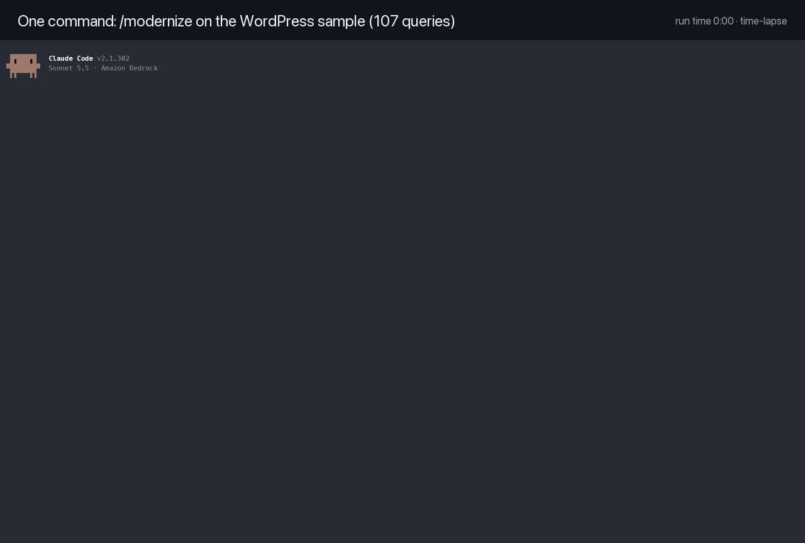

# Run a full database modernization assessment with Claude Code

Give this tool the schema and queries of a monolithic relational database. It tells you which queries belong on which AWS purpose-built engine and designs the target schemas.

```
/modernize docs/examples/wordpress/wordpress-collection.json
```

Run this command in [Claude Code](https://docs.anthropic.com/en/docs/claude-code) with the repository open. The chat reports each phase, and by default a local UI opens next to it: the chat links the job's summary page (the Sankey of queries to engines) at the approval gate and its results page (the headline, the deliverable downloads, the cost, the migration roadmap and the schema designs) at the end.

[Get started with Claude Code](get-started.md){ .md-button .md-button--primary }
[See a sample report](sample.md){ .md-button }

## Demo



*A full `/modernize` run on the WordPress sample (about 7.5 minutes, time-lapsed to 78 seconds) with its one approval gate and final summary, then the job's results and summary pages in the local UI and four pages of the executive report PDF.*

## What it answers

- **Which queries go where.** Every query pattern is scored against every engine that can own it. The assignment is deterministic: the scores decide it, not a model, and all of a table's writes land on one engine, its source of truth.
- **What the target schemas look like.** DynamoDB tables, DocumentDB collections, OpenSearch mappings and the relational schema that stays, all designed from your workload.
- **What it costs and what the risks are.** The same run produces TCO projections and a risk register. The migration roadmap shows a suggested step-by-step path in waves, each with the gate to clear before the next, next to the fully decomposed target.

See [Understand the results](understand-the-results.md) for how to read every deliverable.

--8<-- "README.md:overview"

!!! warning "Sample project"
    This is a sample project intended for educational and evaluation purposes. It requires proper review, testing, and modification before use in production environments. Use at your own risk.
