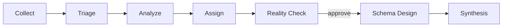

# Use Claude Code

`/modernize` is the main entry point. Each phase is also its own command, so you can run one step at a time or re-run a step after a change.

## How `/modernize` works



`/modernize` runs in one of three modes: `chat`, `ui` or `both` (the default). In `ui` and `both` it starts the local API and UI before the pipeline. The chat always shows the approval gate's numbers, so you can decide from the chat alone; in `chat` and `both` it also summarizes each phase. In `ui` and `both` it links the job's own pages, as printed by `scripts/start_local_ui.py --page`: the summary page with the Sankey and the query-to-engine breakdown at the Reality Check approval (`http://localhost:3000/analysis/monitor/summary/<job_id>`), and the results page, with the schema designs and the full report, at the end (`http://localhost:3000/analysis/results/<job_id>`). If the UI can't start (a busy port, a failed build, or no Node), the run switches to chat and continues.

Use `/modernize docs/examples/wordpress/wordpress-collection.json --mode chat` for a terminal-only run: no browser, no Node required, works in headless environments. `wordpress-collection.json` is bundled as `docs/examples/wordpress/wordpress.zip`; the script extracts it next to the zip the first time you name it, so there is nothing to unzip by hand.

### Options

| Option | What it does |
| --- | --- |
| `<collection.json>` | The collector output to assess (required) |
| `--mode <mode>` | `both` (the default): chat plus the local UI; `chat`: chat only; `ui`: the UI, with chat giving only the approval numbers and the links |
| `--auto` | Unattended: approves the assignment and settles engine ties for you, each marked for review |
| `--target-databases <ids>` | The engine scope: the only engines the plan may use, for example `dynamodb,aurora_postgresql` (see [Limit the engines the plan may use](#limit-the-engines-the-plan-may-use)) |
| `--engines-in-use <ids>` | Other AWS databases the application already runs, for example `opensearch,elasticache` (see [Tell the assessment which other engines you already run](#tell-the-assessment-which-other-engines-you-already-run)) |

## The individual commands

| Command | What it does |
| --- | --- |
| `/collect` | Parses collector output and initializes a job |
| `/triage` | Detects workload signals and selects every engine that can own a query for analysis (the signals are evidence, not a filter) |
| `/analyze` | Runs analysis agents for every triage-selected engine |
| `/assign` | Routes each query to its best-scoring engine, with all of a table's writes on one engine |
| `/reality-check` | Consolidates under-committed engines and validates with a model |
| `/design-schema` | Designs target schemas per engine (needs a model) |
| `/synthesize` | Produces the final report and renders the deliverables into `artifacts/<db>/<job>/deliverables/` (see [Understand the results](understand-the-results.md#the-deliverables)) |

Each command is defined in `.claude/commands/` and reads the job state from `.modernizer-state.json`, so you can run them out of order to re-do a single phase after changing an earlier decision.

## Analyzing your own database

Run the read-only collection script for your database engine instead of the sample zip:

```bash
# PostgreSQL (needs the pg_stat_statements extension)
psql -U <user> -h <host> -d <database> -t -A -f scripts/collect-postgresql.sql > <database>-collection.json

# MySQL or MariaDB (needs performance_schema)
mysql -N -u <user> -p -h <host> -D <database> < scripts/collect-mysql.sql > <database>-collection.json

# SQL Server 2016 or later (needs VIEW SERVER STATE for the query section);
# sqlcmd reads the password from SQLCMDPASSWORD, so it stays off the command line
sqlcmd -S <host>,<port> -U <user> -d <database> -C -y 0 -i scripts/collect-sqlserver.sql > <database>-collection.json
# The SQL Server query statistics are server-wide: connect with -d <database> (the database to assess).
# The query section keeps that database's statements, and each query row carries its database_name.

# Oracle 12.2 or later (needs SELECT_CATALOG_ROLE)
sqlplus -S <user>/<password>@<host>:<port>/<service> @scripts/collect-oracle.sql > <database>-collection.json
```

Db2 has no collection script yet. The scripts only run `SELECT` on catalog and statistics views (`information_schema`, `pg_stat_statements`, `performance_schema`, the SQL Server `sys` views, the Oracle `V$` and `ALL_*` views). They never change your database and never read table rows: the collection holds the schema, query shapes and counters. Query text and view, procedure and trigger definitions can still carry literal values. Then run `/modernize <database>-collection.json` (or `/collect`) instead of the sample.

Any file name works: `/modernize` names the run from the file name (`shop-collection.json` becomes `shop`), and `scripts/run_assessment.py` from `--db`, while the tables are keyed by the database name the collection records, so the name you pick doesn't change the plan.

Every ingestion path (`/modernize`, `scripts/run_assessment.py --file`, `scripts/run_collect.py --file`, the local UI upload, and the AWS Transform upload) rejects a collection above 100 MB or above 50,000 tables or 20,000 queries, with a clear error naming the limit that was hit. These defaults comfortably cover the bundled samples and the larger query collections proposed in [#384](https://github.com/aws-samples/sample-aws-genai-db-modernizer/issues/384); raise them with the `MODERNIZER_MAX_UPLOAD_BYTES`, `MODERNIZER_MAX_UPLOAD_TABLES`, and `MODERNIZER_MAX_UPLOAD_QUERIES` environment variables.

### Tell the assessment which other engines you already run

A saving for retiring an engine counts only if you run that engine today, so the collection records which ones. The source engine is always recorded. If the application also uses another AWS database, for example an OpenSearch domain or an ElastiCache cluster, declare it when you ingest the collection: `uv run python scripts/run_collect.py --file <database>-collection.json --engines-in-use opensearch,elasticache` (`scripts/run_assessment.py` takes the same option). The ids are the engine ids (`opensearch`, `elasticache`, `documentdb`, `dynamodb`, `aurora_mysql`, `aurora_postgresql`; the legacy `aurora` is refused); an unknown id is refused with the list. They are added to any `metadata.engines_in_use` the file already lists, and a collection that declares nothing behaves as before: only the source engine counts. `/modernize` and `/collect` accept the same `--engines-in-use` argument and pass it on. A live collector run reads the same list from the `ENGINES_IN_USE` environment variable. The create-analysis form's offline upload has a multi-select for the same list, and the Assessments API takes it as `engines_in_use`.

### Limit the engines the plan may use

By default every engine is considered. To limit the plan to the engines you want, give the engine scope: `/modernize <database>-collection.json --target-databases dynamodb,aurora_postgresql`, or the same `--target-databases` option on `uv run python scripts/run_assessment.py --file <database>-collection.json --db <database>`. The Assessments API takes it as `target_databases`, and the create-analysis form's target database checkboxes send it.

The ids are the active engine ids (`dynamodb`, `aurora_postgresql`, `aurora_mysql`, `documentdb`, `opensearch`, `elasticache`), in any case, each counted once; an empty list, the legacy `aurora`, a planned engine (`neptune`, `keyspaces`) or an unknown id is refused with the reason. The scope is recorded in the job's `decisions/engine_scope.json`, and every deliverable states it ("Engines in scope: Aurora PostgreSQL, DynamoDB (customer's choice)"). A MySQL source scoped to DynamoDB and Aurora PostgreSQL moves its relational queries to Aurora PostgreSQL.

When no engine in the scope can serve a query (for example DynamoDB alone for a relational workload), the run still finishes: those queries get no engine, stay out of every migration wave and schema design, and the risk register lists them as a high risk that names an engine that could serve them. A job's scope is fixed once it starts, so start a new run with an engine added to the scope to place them. Jobs started through AWS Transform take no scope yet (#1356).

## Optional: attach an Amazon Bedrock Guardrail

If Claude Code reaches the model through Amazon Bedrock (`CLAUDE_CODE_USE_BEDROCK=1`), you can attach a guardrail you own to every model call it makes, including the ones `/modernize` triggers. It is off unless you set it. Claude Code sends the two headers below with each request, and Bedrock applies the guardrail to it.

Set `ANTHROPIC_CUSTOM_HEADERS` in your Claude Code settings (for example `~/.claude/settings.json`). The two headers are separated by a newline:

```json
{
  "env": {
    "ANTHROPIC_CUSTOM_HEADERS": "X-Amzn-Bedrock-GuardrailIdentifier: <guardrail-id>\nX-Amzn-Bedrock-GuardrailVersion: <guardrail-version>"
  }
}
```

- The version must be a published, numbered version. `DRAFT` is not accepted.
- If Claude Code uses a cross-region inference profile (the `us.` model IDs are one), a guardrail without a cross-region guardrail profile worked with the default `us.` model IDs when attached to this project's own Bedrock calls (`--llm-mode bedrock`), so the template's `CrossRegionGuardrailProfileArn` is optional. The Claude Code header setup itself has not been verified against a deployed guardrail. The prompt-attack filter may flag Claude Code's own prompts and skill text; that has not been tested, so try a run with the guardrail on before relying on it.
- The role that makes the calls needs `bedrock:ApplyGuardrail` on the guardrail.
- When the guardrail blocks a reply while it streams, the text received so far stays in the chat and the reply ends with the guardrail's blocked message.

Known limit: this header setup is unverified against a deployed guardrail.

[`infrastructure/cloudformation/bedrock-guardrail.yaml`](https://github.com/aws-samples/sample-aws-genai-db-modernizer/blob/main/infrastructure/cloudformation/bedrock-guardrail.yaml) defines a guardrail with a prompt-attack filter on inputs and PII filters on outputs, plus a published version. Deploying it is up to you; its `GuardrailId` and `GuardrailVersion` outputs are the two values above. For the same guardrail on `--llm-mode bedrock` runs, see [Other ways to run it](other-ways-to-run-it.md#attach-a-guardrail-optional).

## Headless runs

`claude -p "/modernize <collection.json> --auto --mode <chat|ui|both>"` runs the whole pipeline without prompts. `/modernize` uses `--mode` when given and `both` otherwise, and `--auto` approves the one decision for you. CI uses this to test the pipeline against a real model; see `ci/e2e-llm.sh` and [AGENTS.md](https://github.com/aws-samples/sample-aws-genai-db-modernizer/blob/main/AGENTS.md#headless-rules-modernize---auto) for the full rules. Most users don't need it.
