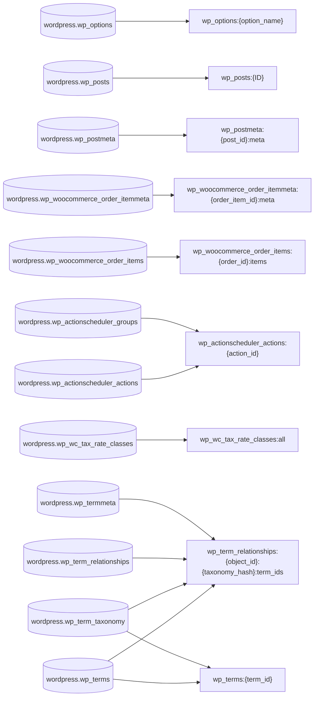

## Migration map (22 tables: 20 migrate, 2 to the cache layer)

| Source table | Target engine | Target | Pattern | Confidence |
|---|---|---|---|---|
| `wordpress.wp_actionscheduler_actions` | DynamoDB | `wp_actionscheduler_actions` | separate | 85 |
| `wordpress.wp_actionscheduler_groups` | DynamoDB | `wp_actionscheduler_actions` | separate | 90 |
| `wordpress.wp_actionscheduler_logs` | DynamoDB | `ActionSchedulerLogs` | identifying_relationship | 72 |
| `wordpress.wp_commentmeta` | DynamoDB | `CommentMeta` | identifying_relationship | 64 |
| `wordpress.wp_comments` | Aurora MySQL | `wp_comments` | relational_table | 74 |
| `wordpress.wp_options` | DynamoDB | `wp_options` | separate | 89 |
| `wordpress.wp_postmeta` | Aurora MySQL | `wp_postmeta` | relational_table | 81 |
| `wordpress.wp_posts` | DynamoDB | `wp_posts` | separate | 82 |
| `wordpress.wp_term_relationships` | DynamoDB | `WpTermRelationships` | separate | 86 |
| `wordpress.wp_term_taxonomy` | DynamoDB | `wp_terms` | item_collection | 84 |
| `wordpress.wp_termmeta` | DynamoDB | `wp_terms` | item_collection | 85 |
| `wordpress.wp_terms` | DynamoDB | `wp_terms` | item_collection | 85 |
| `wordpress.wp_usermeta` | Aurora MySQL | `wp_usermeta` | relational_table | 80 |
| `wordpress.wp_users` | DynamoDB | `wp_users` | separate | 89 |
| `wordpress.wp_wc_admin_notes` | Aurora MySQL | `wp_wc_admin_notes` | relational_table | 62 |
| `wordpress.wp_wc_product_meta_lookup` | Aurora MySQL | `wp_wc_product_meta_lookup` | relational_table | 74 |
| `wordpress.wp_wc_reserved_stock` | DynamoDB | `WcReservedStock` | identifying_relationship | 72 |
| `wordpress.wp_wc_tax_rate_classes` | DynamoDB | `WcTaxRateClasses` | separate | 95 |
| `wordpress.wp_woocommerce_api_keys` | DynamoDB | `WooApiKeys` | separate | 95 |
| `wordpress.wp_woocommerce_downloadable_product_permissions` | DynamoDB | `WooDownloadablePermissions` | identifying_relationship | 69 |
| `wordpress.wp_woocommerce_order_itemmeta` | ElastiCache | `wp_woocommerce_order_itemmeta:{order_item_id}:meta` | hash | 79 |
| `wordpress.wp_woocommerce_order_items` | ElastiCache | `wp_woocommerce_order_items:{order_id}:items` | hash | 83 |

## Cache layer (ElastiCache)

ElastiCache fronts 15 hot reads (77.5% of calls, 172.1 calls/s) cache-aside. It owns none of the workload: each cached read stays with its owner engine, which serves every miss and every write. It fronts Aurora MySQL with no data migration of its own, and keeps serving the same reads as their owners move in later waves: invalidation follows the engine that owns each cached table.

- Owner engines: Aurora MySQL 9, DynamoDB 6
- Read shapes: point lookup 14, reference read 1
- Eligible: a SELECT at ≥ 1 calls/s returning ≤ 100 rows on average, with a point, top-N, session or small reference-read shape, on tables that are not write-heavy.
- 20 hot reads \(83.4% of calls\) were assigned at the assignment gate. The ElastiCache schema design covers 15 of them; the other 5 are no longer cached and stay served by their owner engine. 15 hot reads \(77.5% of calls\) remain.

### ElastiCache (9 target objects, 15 access patterns)

| Target | Pattern | Source tables | GSIs | TTL(s) |
|---|---|---|---|---|
| `wp_options:{option_name}` | hash | `wordpress.wp_options` | 0 | 3,600 |
| `wp_posts:{ID}` | hash | `wordpress.wp_posts` | 0 | 900 |
| `wp_postmeta:{post_id}:meta` | hash | `wordpress.wp_postmeta` | 0 | 900 |
| `wp_woocommerce_order_itemmeta:{order_item_id}:meta` | hash | `wordpress.wp_woocommerce_order_itemmeta` | 0 | 900 |
| `wp_woocommerce_order_items:{order_id}:items` | hash | `wordpress.wp_woocommerce_order_items` | 0 | 900 |
| `wp_actionscheduler_actions:{action_id}` | hash | `wordpress.wp_actionscheduler_actions`, `wordpress.wp_actionscheduler_groups` | 0 | 60 |
| `wp_wc_tax_rate_classes:all` | string | `wordpress.wp_wc_tax_rate_classes` | 0 | 86,400 |
| `wp_term_relationships:{object_id}:{taxonomy_hash}:term_ids` | list | `wordpress.wp_terms`, `wordpress.wp_term_taxonomy`, `wordpress.wp_term_relationships`, `wordpress.wp_termmeta` | 0 | 600 |
| `wp_terms:{term_id}` | hash | `wordpress.wp_terms`, `wordpress.wp_term_taxonomy` | 0 | 3,600 |

**Unsupported patterns (5):**

- **unsupported pattern** (`fcfd82fa`) — Slug uniqueness check \(post\_name with ID \!= ?\) must see committed state; a stale cached answer could allow duplicate slugs. Keep on the owner database, which enforces the check consistently.
- **unsupported pattern** (`52da34b1`) — Lookup by post\_title with a status list and ordering is an ad hoc filter with a very high-cardinality key space and a near-zero hit rate \(0 rows returned on average\). Serve from the owner database.
- **unsupported pattern** (`f31a66f5`) — Child-post listing with an eight-value status filter and descending date sort; the many filter combinations and zero rows returned make it a poor cache candidate. Serve from the owner database.
- **unsupported pattern** (`d4bf16d6`) — Paginated listing with SQL\_CALC\_FOUND\_ROWS and compound sort; it would need a sorted set per filter combination and invalidation on every post write. Serve from the owner database.
- **unsupported pattern** (`06584926`) — Queue-style lookup of the next scheduled action by hook and status; it needs fresh state to avoid running an action twice. Serve from the owner database.

